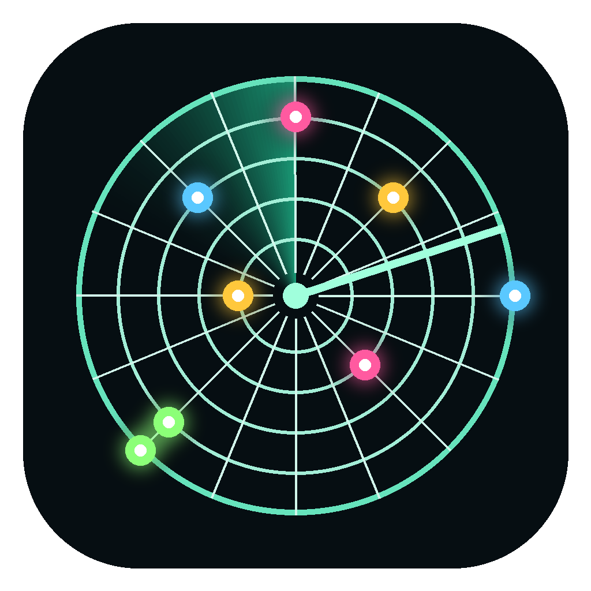

# Orbit

A sonar-style loop sequencer for Mac and Windows. Notes sit on rings around a circle. A sweep line goes round the circle and plays each note as it passes.



## Using Orbit

| Action | How |
|---|---|
| Place a note | Click any ring (or between two rings; it snaps to the nearest ring) |
| Edit one note's sound | Click the note. The right-hand panel then edits only that note |
| Edit a whole ring | Click the ring's name in the **Rings** list on the left |
| Edit the default sound | Click empty space outside the circle, press `Esc`, or click **Default sound** |
| Move a note | Drag it, or select it and use the arrow keys (← → step, ↑ ↓ ring) |
| Delete a note | Right-click it, Option/Alt-click it, or select it and press `Delete` |
| Play / stop | Click the centre of the circle, the play button, or press `Space` |
| Undo / redo | `⌘Z` / `⌘⇧Z` (Ctrl on Windows) |

Each note uses its own sound if it has one. If it doesn't, it uses its ring's sound, and if the ring has none either, it uses the default sound. A note or ring with its own sound has a dot in the middle. Drum sounds are drawn as diamonds.

**Timing:** *Loop* sets how many bars one trip round the circle takes (½, 1, 2, 4 or 8). *Grid* sets the step size: 1/4, 1/8, 1/8T, 1/16, 1/16T or 1/32. Notes snap to the grid; turn off **Snap** to place them anywhere. *Swing* delays every second 16th note.

**Tuning:** Inner rings play lower notes. *Key*, *Scale* and *Octave* set which note each ring plays. You can shift a single ring with its *Ring Note* knob.

**Sound panel:**
- **Source:** Synth or Drum.
  - Synth: sine, triangle, saw or square wave, or *Custom*, where you draw 16 harmonics. Also unison voices and spread, wavefolder, noise, a second oscillator (wave, octave, semitone, detune) and FM.
  - Drum: 13 synthesised drums (kick, 808, snare, clap, closed and open hats, tom, rimshot, cowbell, crash, shaker, blip and zap), each with decay, tone and snap.
- **Pitch:** transpose, fine tune, pitch envelope, vibrato
- **Envelope:** attack, decay, sustain, release, and note length
- **Filter:** low-pass, high-pass, band-pass or notch, with cutoff, resonance and envelope amount
- **Distortion:** drive, mix, bit-crush
- **EQ:** low and high shelves, plus a mid band with adjustable frequency
- **Echo:** tempo-synced time, feedback, tone, mix
- **Reverb:** size, damping, mix
- **Output:** volume, pan

Knobs: drag up or down, scroll, hold Shift for fine control, double-click to reset. **Presets**, **Copy** / **Paste** and **Reset** sit at the top of the panel.

**Files:**
- **Save** writes a `.orbit` project file. On Mac, double-clicking one opens it in Orbit.
- **Export** creates:
  - **MP3** (128–320 kbps) or **WAV** (44.1 kHz, 16-bit). The loop can repeat 1–16 times. The ending can be a seamless loop (echo and reverb tails wrap back to the start), ring out, or cut off hard at the end of the loop.
  - **MIDI**, with one track per ring. Drums go on channel 10 using General MIDI drum notes.

## Building with GitHub (no Xcode needed)

GitHub Actions does the builds on GitHub's own Mac and Windows machines, so nothing needs to be installed on your computer.

1. Create a new **empty** repository on GitHub, e.g. `orbit`.
2. Push this folder to it:
   ```bash
   cd Orbit
   git init
   git add .
   git commit -m "Orbit 1.0.0"
   git branch -M main
   git remote add origin https://github.com/YOUR-USERNAME/orbit.git
   git push -u origin main
   ```
   (Or use GitHub Desktop and choose *Add Existing Repository* for this folder.)
3. Open the **Actions** tab. The *Build Orbit* workflow builds both apps in about 5–10 minutes. Open the finished run and download them under **Artifacts**:
   - `Orbit-mac`: `Orbit-1.0.0-mac-x64.dmg` (Intel) and `Orbit-1.0.0-mac-arm64.dmg` (Apple Silicon)
   - `Orbit-win`: `Orbit-Setup-1.0.0.exe` (installer) and `Orbit-Portable-1.0.0.exe`
4. **To publish a release** with download links on the repo's Releases page, push a version tag:
   ```bash
   git tag v1.0.0
   git push origin v1.0.0
   ```
   Bump `"version"` in `package.json` before tagging each new release.

### First launch: unsigned app warnings

The builds aren't signed with a paid Apple or Microsoft certificate, so both systems warn you the first time you open Orbit:

- **macOS (Sequoia):** Open the app once. Then go to **System Settings → Privacy & Security**, scroll down, and click **Open Anyway** next to the Orbit message. If macOS says the app is "damaged", run this in Terminal:
  `xattr -dr com.apple.quarantine /Applications/Orbit.app`
- **Windows:** On the SmartScreen prompt, click **More info**, then **Run anyway**.

## Running from source (optional)

You need Node.js 20 or newer:

```bash
npm install
npm start
```

## Project layout

```
main.js / preload.js       Electron main process (window, menus, file dialogs)
src/index.html, styles.css UI
src/js/sound.js            Sound parameters, presets, scales
src/js/engine.js           Web Audio engine: synth & drum voices, FX strips, scheduler, offline render
src/js/sonar.js            The sonar circle (canvas) and mouse interaction
src/js/panel.js            Sound editing panel
src/js/knob.js             Knob control
src/js/exporters.js        MIDI / WAV / MP3 writers
src/js/app.js              App state, undo, files, export
.github/workflows/build.yml  GitHub Actions: Mac + Windows builds and releases
```

MP3 encoding uses [lamejs](https://github.com/zhuker/lamejs) (LGPL-3.0), stored in `src/vendor/`.
